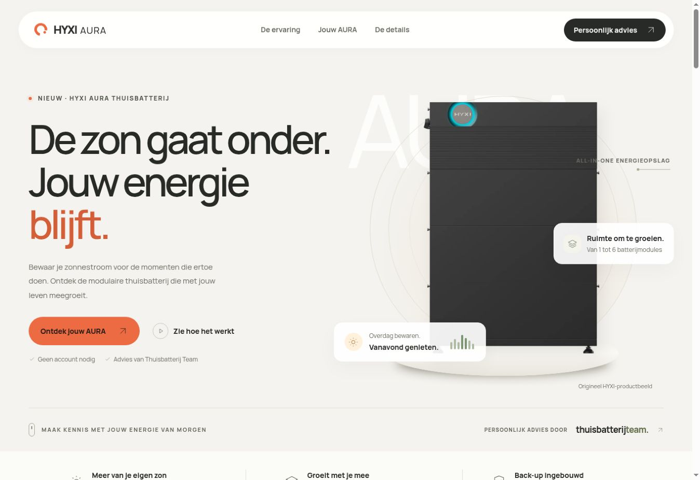

# HYXI AURA · hyxi-aura.nl

> **Actueel 16 november 2026:** De HYXI AURA-leadketen is bewezen tot en met de via inkomende e-mail aangemaakte Odoo-verkoopkans. De site, password-only `/beheer`, versleutelde MariaDB-opslag, betrouwbare teammail, onafhankelijke publieke monitor en `/offerte/` staan live. **Hostinger's dagelijkse automatische backups zijn door de eigenaar bevestigd en afgevinkt**; er is geen eigen backupimplementatie nodig en er is geen onafhankelijk herstelbewijs geclaimd. Nog te bouwen: privacyretentie/verwijderproces, taakherinneringen, privacyvriendelijke KPI's, Search Console/SEO-content en verdere conversie-/UX-optimalisatie. Zie [actuele roadmap](docs/ROADMAP-FASTLANE-2026-11-16.md), [bewijsstatus](docs/STATUS-P0-P1-2026-11-16.md) en [nieuwe startprompt](docs/NEXT-AGENT-FASTLANE-2026-11-16.md).

Een interactieve Nederlandse productervaring voor de HYXI AURA thuisbatterij. Bezoekers ontdekken de werking, verkennen een modulaire opstelling en vragen persoonlijk advies aan bij **Thuisbatterij Team**. De website is een initiatief van **NIVO Groep Holland B.V.** en is geen officiële HYXI-website.

## Wat zit erin?

- Een productpagina met officiële HYXI-beelden en een illustratief sfeerbeeld.
- Een interactieve woning met zonnige middag, avond en stroomuitval, telkens met en zonder batterij.
- Een configurator voor één tot zes BAT-Q7- of BAT-Q9-modules, met totale én bruikbare capaciteit.
- Een aanvraag in drie stappen, inclusief de gekozen configuratie en expliciet verzoek om contact.
- Een aparte mobiele offerteaanvraag op `/offerte/`, inclusief gewenste modules en optionele installatievraag; herkenbaar als `quote` in Beheer en interne e-mail.
- Een afgeschermde werkbank met statussen, toewijzing, zoeken op aanvraagnummer en versleutelde vervolgacties en notities.
- Servervalidatie en SMTP-aflevering bij het team, met bescherming tegen misbruik en dubbele verzending.
- Statische, leesbare productinhoud, FAQ, bronpagina, privacyverklaring, fabrikant-PDF's, sitemap en metadata.

De adviesaanvraag is geen bestelling. Prijs, technische geschiktheid en leverbaarheid worden persoonlijk bevestigd.



Bekijk ook de [interactieve energie-ervaring](docs/screenshots/energy-experience.jpg) en het [verificatieoverzicht](docs/VERIFICATION.md).

## Techniek

**Node.js 24** met Express verzorgt de API en serveert de productiebuild. **Vite** bouwt de HTML-, CSS- en JavaScript-bestanden en staat bewust in `dependencies`: Hostinger installeert bij de productie-deploy geen `devDependencies`. **Three.js** laadt voor de interactieve woning; bij ontbrekende WebGL blijft de uitleg beschikbaar. **Nodemailer** verstuurt aanvragen via de ingestelde mailbox. **Zod** valideert de serverinvoer. Manrope en alle gebruikte webbeelden worden lokaal geserveerd.

De codefallback blijft SMTP-mailmodus, maar **productie werkt aantoonbaar in versleutelde database-modus met een ingelogd Beheer-dashboard**. Een nieuw deploy zet geen private featureflags uit zichzelf aan. Er is geen publieke registratie, nieuwsbrief, advertentiepixel of analysetracker. Geheimen blijven uitsluitend in de hostingomgeving of een lokale, genegeerde `.env`.

## HYXI AURA 2.0 — volgende ontwikkelfase

De database-, auth- en beheerontwikkeling is samengebracht in [PR #13](https://github.com/Michaelwmdegroot/hyxi-aura-nl/pull/13). De eerdere PR's #11/#12 zijn tussenstappen. De [overdracht van 15 november](docs/BEHEER-RELEASE-2026-11-15.md) bevat de gevonden problemen, oplossingen, testaanpak en actuele hostinggrens. Voor activering: [Hostinger MySQL-handleiding](docs/DATABASE-HOSTINGER-V2.md).


De eigenaar heeft de werkende V1-landingspagina op 14 november 2026 als mijlpaal geaccepteerd (visueel 7/10). De database, betrouwbare e-mail, het dashboard en de aparte offerteaanvraag zijn inmiddels op productie gerealiseerd. **SEO Search Console en privacyvriendelijke analytics zijn nog werkpakketten**, net als automatisering van vervolgacties en privacyretentie.

- [Master-issue #10 en werkpakketten](https://github.com/Michaelwmdegroot/hyxi-aura-nl/issues/10)
- [Projectplan en roadmap](docs/PROJECT-PLAN-V2-2026-11-14.md)
- [Technische architectuur](docs/ARCHITECTURE-V2.md)
- [Livegangchecklist](docs/GO-LIVE-CHECKLIST-V2.md)

De werkelijke SMTP-inboxontvangst is eerder aangetoond en de e-mailimport naar Odoo bevestigd. Raadpleeg de [roadmap](docs/ROADMAP-FASTLANE-2026-11-16.md) in plaats van die historische controle als open blokkade te behandelen.

### Beheer-MVP en hostinginrichting

De beheerwerkbank bevat wachtwoordlogin zonder authenticator, rolgecontroleerde dossiers, statussen, toewijzing, mailincidenten, audit en veilig terminalaccountbeheer. Nieuwe endpoints blijven gesloten bij `ADMIN_ENABLED=false`. Database-migraties en eigenaaraccount kunnen worden voorbereid terwijl de bestaande site in mailmodus blijft. Zie [BEHEER-MVP.md](docs/BEHEER-MVP.md) en het aanvullende [env-sjabloon](config/beheer.env.example). De live-healthcheck op 15 november vóór deze wijzigingen gaf `leadEnabled:false`; echte inboxontvangst en de private Hostinger-inrichting zijn nog afzonderlijk te bevestigen.

## Lokaal starten

Gebruik Node.js 24. Voor ontwikkeling zijn één terminal en één opdracht na installatie voldoende:

```sh
npm ci
npm run dev
```

Open `http://127.0.0.1:5173`. `scripts/dev.mjs` start Vite en de echte aanvraag-API op dezelfde origin. Er is geen voorafgaande build, aparte Express-terminal of handmatige proxywijziging nodig. Met `npm run dev -- --port 5174` kies je een andere poort. Herstart de devserver na wijzigingen aan servercode.

Gebruik indien nodig `.env.example` als voorbeeld voor een lokale `.env`. Zet daarbij `NODE_ENV=development`; de devserver weigert `NODE_ENV=production`. Laat `LEAD_ENABLED=false` zolang je geen echte aanvragen wilt versturen. Zonder complete mailconfiguratie bevestigt de app geen fictief verzonden aanvraag. Zet nooit echte mailboxwachtwoorden of persoonsgegevens in Git.

Voor een controle van de gebouwde website:

```sh
npm run build
npm start
```

Die server gebruikt normaal `http://localhost:3000` en vereist wel een bestaande `dist`. Gebruik bij lokale HTTP-controles `NODE_ENV=development` of `test`. De echte productieomgeving gebruikt `NODE_ENV=production` en HTTPS.

### Het volledige formulier testen zonder e-mail te versturen

```sh
QA_MAIL_MODE=accept npm run dev:qa
```

Open `http://127.0.0.1:4173`. Deze aparte QA-omgeving gebruikt de echte validatie en aanvraagroute met uitsluitend een SMTP-testvervanger. Gebruik `QA_MAIL_MODE=reject npm run dev:qa` om een mailafwijzing te simuleren. De Vite-frontend en test-API worden samen gestart en gestopt; een proxybestand hoeft niet te worden aangepast.

`/__qa/state` toont de simulatiemodus, aantallen pogingen/acceptaties/afwijzingen, de laatste responsstatus en het gekozen productprofiel. Het toont geen naam, e-mailadres, telefoonnummer, postcode of campagnegegevens. Gebruik fictieve invoer. De QA-server bindt aan loopback, gebruikt geen echte SMTP-inloggegevens en weigert productiegebruik. Deploy altijd `server.mjs`.

## Scripts

| Commando | Functie |
| --- | --- |
| `npm run dev` | Vite en de echte aanvraag-API op één origin; geen prebuild nodig |
| `npm run dev:server` | Alleen de Express-server voor een bestaande build, met eventuele lokale `.env` |
| `npm run dev:qa` | Volledige lokale preview met gesimuleerde SMTP-aflevering; geen echte e-mail |
| `npm run build` | FAQ en bijpassende structured data naar HTML schrijven, daarna productiebuild maken |
| `npm start` | Gebouwde website en API uitvoeren |
| `npm test` | Unit- en integratietests; geen echte e-mail |
| `npm run check` | De build controleren op pagina's, interne links, assets, schema, PDF's en publieke bestandsgrenzen |
| `npm run test:browser` | Browserflow naar de echte Express-API met een lokale SMTP-testvervanger; geen echte e-mail |
| `npm run test:db` | Test MySQL 8 transacties en outbox uitsluitend op geïsoleerde CI-testdatabase |
| `npm run db:check` | Read-only MySQL-schema- en verbindingcontrole; geen persoonsgegevens zichtbaar |
| `npm run db:migrate` | Alleen handmatige migratie met expliciete bevestiging, nooit automatische productie-DDL |

De browsercontrole vereist een beschikbare Playwright Chromium-browser. Een bestaande browser kan worden opgegeven via `PLAYWRIGHT_CHROMIUM_EXECUTABLE_PATH`. De testsuite installeert niet zelf een browser.

### Lighthouse-bewijs uit GitHub Actions

De workflow **Build and verify** draait voor wijzigingen op `main`, pull requests naar `main` en handmatig via Actions. Naast de volledige teststraat draait een aparte Hostinger-simulatie met `NODE_ENV=production` en `npm ci --omit=dev`, gevolgd door de normale `npm run build` en `npm run check`. Zo faalt GitHub voortaan wanneer een buildtool alleen in development beschikbaar is. Naast de build-, API-, statische en browsertests meet `scripts/audit.mjs` de productiebuild eenmaal als desktop en eenmaal als mobiel. De lokale Express-auditserver heeft mail uitgeschakeld; er worden geen productiecredentials geladen. Het auditscript weigert uitvoering buiten GitHub Actions.

Bij de Actions-run staat een samenvatting en een artifact `lighthouse-<run_id>-<run_attempt>`, zeven dagen beschikbaar. Het bevat `desktop.html`, `desktop.json`, `mobile.html`, `mobile.json`, `summary.md` en `summary.json`, voor zover de meting die bestanden kon maken. De JSON-samenvatting vermeldt de commit, versie, meetinstellingen, cijfers en eventuele fouten.

De beoordelingsdoelen zijn performance ≥90 en accessibility, best practices en SEO 100. Een lagere score geeft een zichtbare reviewwaarschuwing; onvolledige metingen of runtimefouten laten de auditstap mislukken. Een afgeronde workflow betekent daarom niet automatisch dat elk scoredoel is gehaald. Controleer de rapporten. De meting op de runner is geen veldmeting van Core Web Vitals en omvat geen openbare hostinglatency, DNS, TLS of CDN-gedrag.

## Deployment vanuit main

Importeer deze repository als **Node.js-webapp** bij Hostinger en laat deployen vanaf `main`. Build: `npm run build`. Start: `npm start`. Entry: `server.mjs`. Een puur statische Vite-deploy voert de aanvraag-API niet uit.

Volg [docs/HOSTINGER.md](docs/HOSTINGER.md) voor de instellingen, SMTP, toegestane domeinen, HTTPS, proxyconfiguratie en de eerste echte mailboxcontrole. Het koppelen van het domein en de daadwerkelijke hosting-/mailinstellingen gebeurt apart van het vastleggen van de code op GitHub.

## Waar staan de brongegevens?

| Bestand | Betekenis |
| --- | --- |
| `src/product-data.mjs` | Gecontroleerde modulegegevens, officiële bronlinks en FAQ |
| `src/configurator-model.mjs` | Capaciteitsberekening op basis van die modulegegevens |
| `src/energy-model.mjs` | Vereenvoudigde uitlegsituaties, geen prestatie- of besparingsprognose |
| `public/downloads/` | Ongewijzigde fabrikantdocumenten |
| [docs/PRODUCT-SOURCES.md](docs/PRODUCT-SOURCES.md) | Productfeiten, voorlopige status en grenzen aan claims |
| [docs/ASSETS.md](docs/ASSETS.md) | Beeldherkomst, gegenereerd sfeerbeeld en fontlicentie |
| [docs/SEO-STRATEGY.md](docs/SEO-STRATEGY.md) | Eigen bezoekerswaarde, zoekintentie en aanpak van de andere domeinen |

De huidige productbasis is **HYXI V2.1 van 26 oktober 2026, Preliminary**, gecontroleerd op **14 november 2026**. Houd bij updates de gegevensmodule, zichtbare specificatietabel, uitleg en downloads gelijk. Bewerk FAQ-inhoud in de gegevensmodule: de build schrijft deze opnieuw naar `index.html`.

## Kwaliteitscontrole en praktische grenzen

Voor een release horen de build, unit-/integratietests, statische controle en browserflow te slagen. Beoordeel daarnaast de echte vormgeving op desktop en mobiel, toetsenbordbediening, verminderde beweging en de situatie zonder WebGL. Automatische controles zijn geen volledige toegankelijkheidsverklaring of bewijs van een gegarandeerde Lighthouse-score.

Een geslaagde test met een SMTP-testvervanger bewijst de aanvraaglogica. De eerste echte aflevering in de bedoelde mailbox moet na hostingconfiguratie afzonderlijk worden gecontroleerd. De app toont succes zodra de mailserver de aanvraag voor de teamontvanger accepteert; dat bewijst op zichzelf geen inboxplaatsing. `leadEnabled: true` op `/api/health` betekent dat configuratie aanwezig is, niet dat de mailboxverbinding is getest.

Snelheidslimieten en ontvangstkenmerken bestaan in het geheugen van één serverproces. Ze verdwijnen bij een herstart en worden niet gedeeld tussen meerdere processen. Gebruik voor deze release één instance. De website schrijft geen leadgegevens naar schijf; ontvangen aanvragen staan wel in de teammailbox. Bewaartermijnen en verwijdering in mailbox en eventuele werkadministratie zijn beheertaken.

Deze eerste release schrijft niet rechtstreeks naar Odoo of de NIVO Portal. Er zijn geen gegarandeerde besparingen, terugverdientijden, voorraadclaims of zoekposities. De andere domeinen worden door deze repository niet aangepast. Verdere automatisering, een duurzaam leadregister en een gecontroleerde CRM-koppeling kunnen op deze basis worden toegevoegd.
